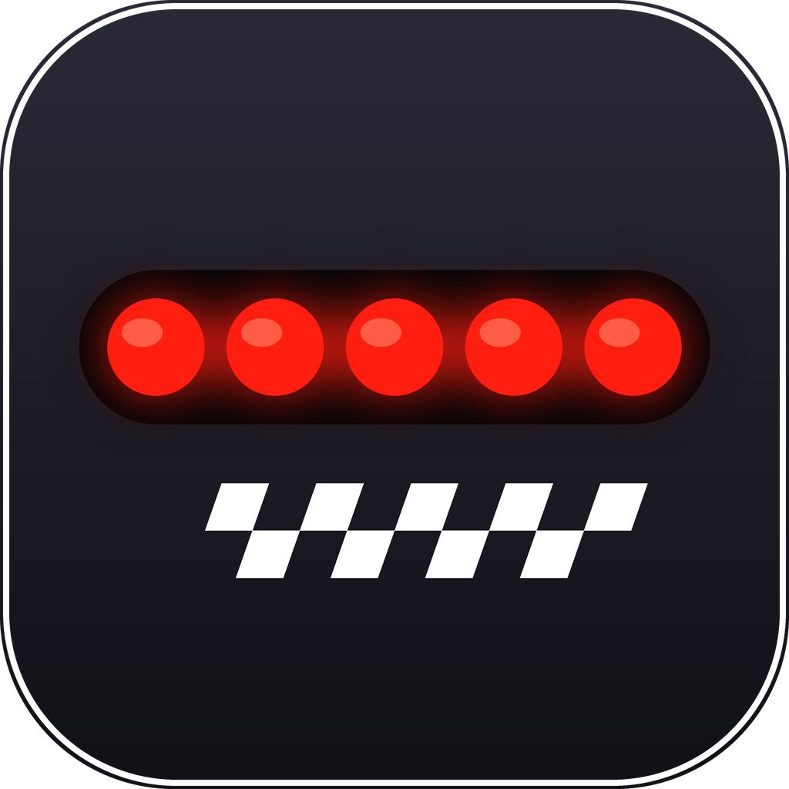

# F1 Analytics Hub 🏁

<div align="center">



**Статистика чемпионата Формулы-1 для телефона и компьютера**

[](https://python.org)
[](https://flet.dev)
[](LICENSE)

Все пилоты и команды сезона · фото и логотипы · сравнение пилотов · календарь · работа без сети

[Скачать](https://github.com/Artist-huh/f1-analytics-hub/releases) • [Сообщить об ошибке](https://github.com/Artist-huh/f1-analytics-hub/issues)


</div>

---

## ✨ Возможности

**🏠 Главная** — ближайшая гонка с обратным отсчётом, баннер LIVE во время сессии, подиум последней
гонки с фото призёров, борьба за титул, лидеры чемпионата и Кубка конструкторов, избранные, быстрый доступ.

**🏆 Чемпионат** — личный зачёт (фото, флаг, команда, очки, отставание от лидера), Кубок
конструкторов (логотип, пилоты, изображение болида, отставание) и **карта сезона**: пилоты × этапы,
клетка окрашена по месту (медали, очковая зона, сход) — в гонках или квалификациях.

**🏎️ Страница команды** — логотип и болид в цветах команды, подиумы, дубли 1–2, поулы, быстрые круги,
сходы, пилоты, дуэль напарников в гонках и квалификациях, график набора очков против лидера Кубка.

**👤 Пилоты** — карточки всех пилотов сезона в цветах команд: официальный портрет, номер,
очки, победы, подиумы; поиск по имени, коду, команде и фильтр по команде.

**📊 Страница пилота** — 8 показателей сезона (очки, победы, подиумы, поулы, быстрые круги, сходы,
лучший и средний финиш), график набора очков против напарника, очки по гонкам, все результаты
с квалификацией, стартовой позицией и отыгрышем.

**⚡ Сравнение 2–4 пилотов** — 13 показателей с подсветкой лучшего значения, общий график
набора очков, личные встречи в гонках и квалификациях (для двоих) или «кто чаще финишировал выше
всех выбранных» (для 3–4). Быстрые наборы: топ-2/3/4, напарники, избранные.

**📅 Календарь** — все этапы с флагами стран, ближайшая гонка с таймером, длиной круга и
расписанием уик-энда в вашем часовом поясе; у прошедших — подиум с фото.

**🛞 Стратегия шин** — для каждой прошедшей гонки: полоса по кругам у каждого пилота, цвет — состав
шин, номера кругов пит-стопов (данные OpenF1).

**🗺️ Трасса** — схема, длина и круги, первый Гран-при, рекордсмены по победам и поулам, лучший круг
в гонке, последние победители и обладатели поула.

**📡 Live-тайминг** (OpenF1) — позиции, отрывы до лидера и интервалы, шины и их возраст, пит-стопы,
сообщения дирекции гонки; во время сессии обновляется каждые 10 секунд, после — итог сессии.

**🏆 Борьба за титул** — сколько очков ещё разыгрывается, кто может стать чемпионом и что нужно
лидеру, чтобы оформить титул досрочно (пилоты и команды).

**📜 История с 1950 года** — любой сезон: чемпион, зачёты, победители гонок; чемпионы всех лет и
рекорды по титулам пилотов, команд и стран.

**🔔 Уведомления** — за час до квалификации, спринта и гонки и итоги избранных пилотов после гонки
(системные на Windows/macOS/Linux и Android, пока приложение запущено).

**🎨 Темы** — тёмная, светлая и «в цветах любимой команды».

**🪟 Мини-виджет** (компьютер) — маленькое окно поверх остальных: таймер до гонки и топ-3.
Виджет на главный экран Android во Flet сделать нельзя: он требует нативного компонента Android.

**⭐ Избранное**, **стратегия** пит-стопов по трассам, **настройки** обновления данных.

Ни один пилот не выделен особо — приложение одинаково работает со всеми гонщиками текущего сезона.

### Горячие клавиши (компьютер)

| Клавиша | Действие |
|---------|----------|
| `F5` | Обновить данные |
| `Ctrl+F` | Поиск пилота |
| `Ctrl+K` | Сравнение пилотов |
| `Ctrl+M` | Мини-виджет |
| `Esc` | Назад |

На Android системная кнопка «назад» ведёт с подэкрана на вкладку, затем на «Главную», и только потом закрывает приложение.

---

## 🎨 Дизайн

Фирменные цвета Формулы-1: красный `#E10600` на угольно-чёрном `#15151E`, белый текст,
тёмно-серые поверхности, красные градиенты и свечение. Цифры и заголовки — **Exo 2** курсивом
(с кириллицей). Экраны сменяются плавно, карточки появляются «лесенкой», при наведении
приподнимаются и подсвечиваются цветом команды, при нажатии — «рябь».


Иконка — собственный знак приложения (курсивные «F1», гоночная полоса, шахматный флаг), см.
`tools/make_icon.py`. Это не официальный логотип Формулы-1.

---

## 🚀 Запуск

### Из исходников

```bash
git clone https://github.com/Artist-huh/f1-analytics-hub.git
cd f1-analytics-hub
pip install -r requirements.txt
python main.py              # окно приложения
flet run --web main.py      # в браузере
```

Windows: двойной клик по `start.bat` (создаст окружение и поставит зависимости при необходимости).

### Готовые сборки

- **Windows** — `F1AnalyticsHub.exe` (Python не нужен), см. [BUILD.md](BUILD.md);
- **Android** — APK под архитектуру процессора: `arm64-v8a` (почти все современные телефоны),
  `armeabi-v7a` (старые), `x86_64` (эмулятор). Собираются в GitHub Actions (артефакт
  `F1AnalyticsHub-Android`) и там же проверяются на эмуляторе Android 14 — см. [BUILD.md](BUILD.md#android);
- **macOS** — `.app` из GitHub Actions.

---

## 🌐 Данные

| Что | Откуда |
|-----|--------|
| Зачёты, результаты гонок, квалификации, спринты, календарь | [Jolpica F1 API](https://github.com/jolpica/jolpica-f1) |
| Соответствие пилот → официальный портрет, live-тайминг | [OpenF1](https://openf1.org) |
| Портреты, логотипы, болиды, схемы трасс | media.formula1.com |
| Чемпионы 1950–2025 | Jolpica, собраны в `data/champions.json` (`tools/build_champions.py`) |
| Флаги | [flagcdn.com](https://flagcdn.com) |

- Всё хранится в SQLite и показывается мгновенно; без сети — последняя сохранённая копия.
- Картинки кэшируются на диск; снимок данных и картинки сезона встроены в сборку
  (`data/seed.json`, `data/media/`) — первый запуск работает даже без интернета.
- Фоновое обновление — раз в 5/10/30 минут; результаты сезона перезапрашиваются только после
  нового этапа, чтобы не тратить лимит API.

---

## 🛠️ Технологии

Python 3.10+ · [Flet 1.0](https://flet.dev) (Flutter) · SQLite · requests · unittest (95 тестов)

```
main.py                    оболочка: навигация, анимация смены экранов, «назад» на Android
design_system.py           палитра F1, шрифты, тени, цвета и медиа-идентификаторы команд, флаги
services/jolpica.py        HTTP-клиент Jolpica: таймауты, повторы, постраничная загрузка
services/db.py             SQLite: кэш API, избранное, настройки, миграции
services/f1_api.py         фасад данных для UI: чтение из БД, фоновое обновление, статус
services/media.py          фото пилотов, логотипы, флаги: адреса, дисковый кэш, запасные картинки
services/stats.py          статистика сезона: победы, поулы, быстрые круги, личные встречи
services/seed.py           снимок данных для первого запуска без сети
services/archive.py        история сезонов и трасс: загрузка по запросу, кэш
services/live.py           live-тайминг (OpenF1)
services/notify.py         уведомления о сессиях и результатах
ui/theming.py              смена темы на лету
ui/state.py                состояние приложения, навигация, сравнение, горячие клавиши
ui/components.py           карточки с анимацией, аватары, логотипы, флаги, график
ui/widgets.py              каркас экрана, вкладки, кнопки, статус сети
ui/screens/                главная, чемпионат, календарь, пилоты, страницы пилота, команды и трассы,
                           сравнение, live, борьба за титул, история, избранное, мини-виджет, «Ещё»
tools/make_icon.py         генератор иконки
tests/                     python -m unittest discover -s tests -t .
```

Данные приложения: `~/.f1_analytics_hub/` на компьютере (переменная `F1_HUB_DB` задаёт свой путь),
папка данных приложения на Android.

---

## 📄 Лицензия и права

Код — MIT. Это неофициальное фан-приложение, не связанное с Formula 1, FIA и командами.
Фото пилотов, логотипы и изображения болидов © Formula 1 и команды — показываются из открытых
источников для некоммерческого использования. Шрифт Exo 2 — SIL Open Font License.
